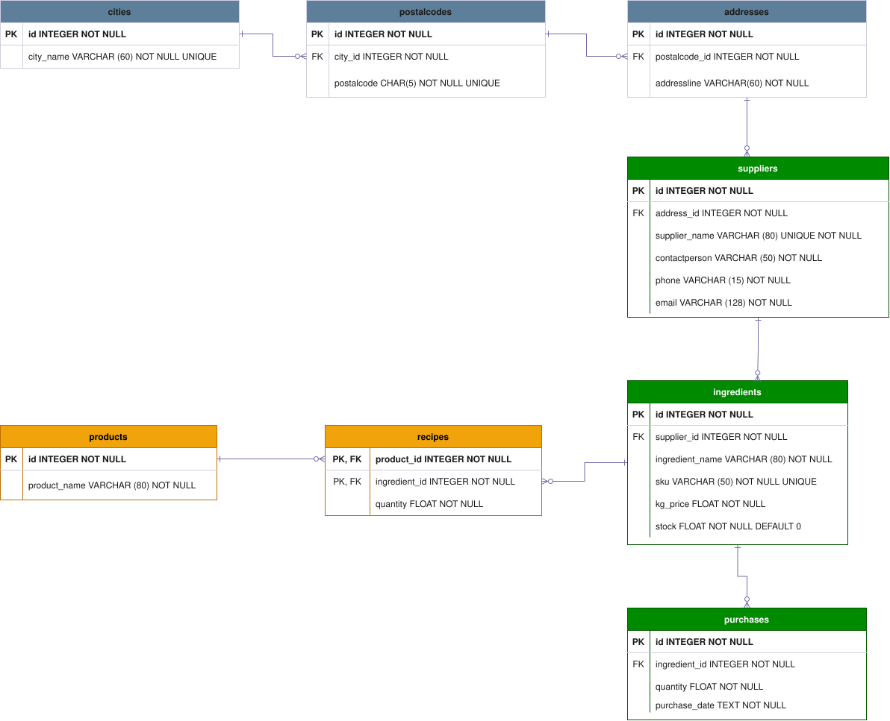

# Mormor Dagnys bageri - databas
Inlämningsuppgift 1 i databashantering. En SQLite-databas med leverantörer, råvaror, recept och registrerade inköp.

## ER-diagram


## Kör skripten
Kräver 'sqlite3'.

```bash
sqlite3 mdb.db < Scripts/createtables.sql
sqlite3 mdb.db < Scripts/addtestdata.sql
sqlite3 mdb.db < Scripts/testqueries.sql
```

Sista testet i `testqueries.sql` ska ge `FOREIGN KEY constraint failed`. Det visar att FK-reglerna stoppar felaktig data.
